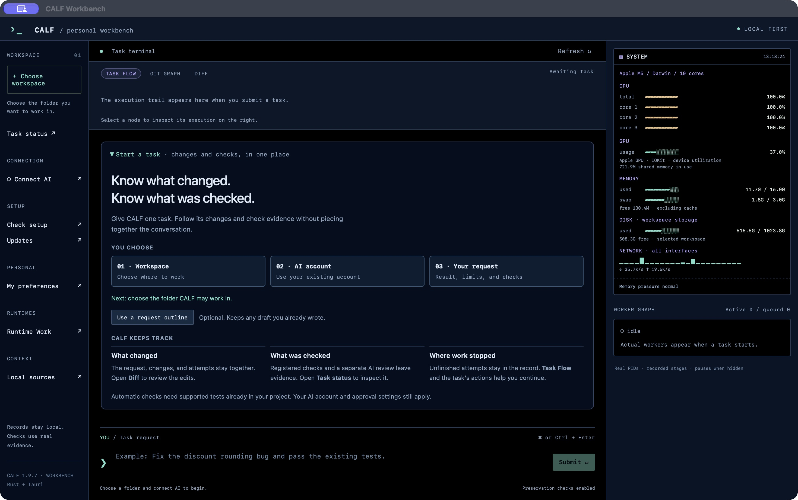
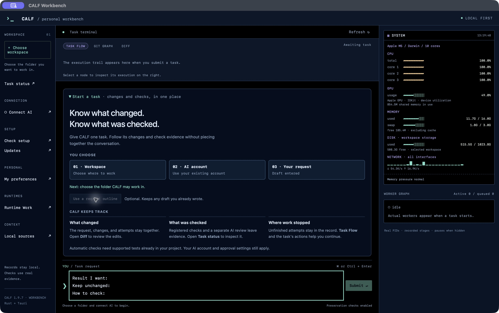

# Your first CALF Workbench task

[Install](INSTALL.md) · [한국어](FIRST_TASK_KR.md) · [Visual manual](CALF_mannual.html#start)

1. Open Workbench and choose **Choose folder**. Select the project CALF may work in.
2. Choose **Connect AI** and use your existing account or configured provider. **Connection saved** reports selected local setup; it is not a live connection test or permission grant.
3. Choose **Use a request outline** in an empty request. Fill in **Result I want**, **Keep unchanged** and **How to check**, then review and choose **Submit**. Existing text is never replaced by the outline button.

The guide folds after a new job appears. Reopen **First task** at any time. Use **Check setup** if you need diagnosis; diagnosis no longer opens automatically on an empty start.

CALF links the request, changes, checks and unfinished attempts. Review Diff and Evidence before using the result. A click, a saved AI connection or the guide itself is not proof that a task passed. Your project must already have meaningful supported checks (unittest, configured pytest, single-package Cargo integration tests, or node:test) and their tools. The outline does not create tests or supply your acceptance criteria.

Example to adapt: “Fix the date parser for empty input; preserve accepted date formats; run the project's existing parser tests.” Use an actual check in your project.

Records remain local. A remote AI receives the bounded task snapshot and explicitly attached references; provider charges and existing approval policies still apply. The images show an isolated macOS 1.9.7 installation with no submitted AI task. Whole-computer metrics in the window are not CALF performance measurements.
