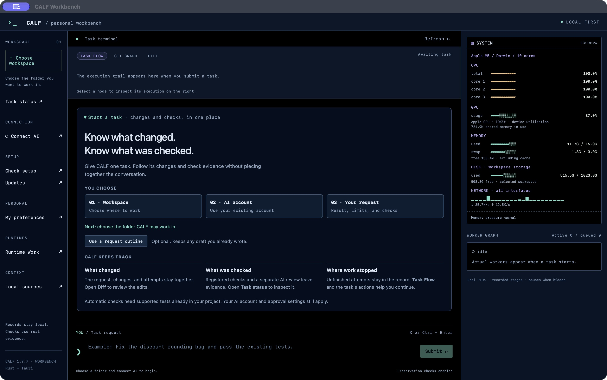
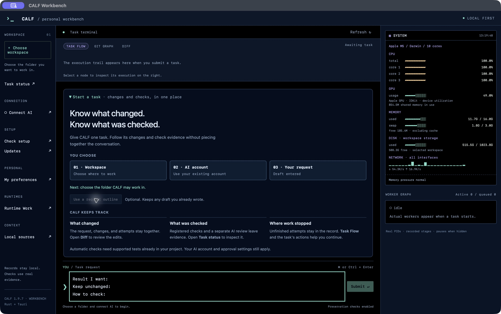

# CALF Workbench 첫 작업

[설치 안내](INSTALL_KR.md) · [English](FIRST_TASK.md) · [화면 매뉴얼](CALF_mannual.html#start)

1. Workbench에서 **Choose folder**를 눌러 CALF가 작업할 프로젝트 폴더를 선택합니다.
2. **Connect AI**에서 기존 계정이나 준비된 공급자에 연결합니다. **Connection saved**는 로컬에 연결 선택이 저장됐다는 표시이며, 실시간 인증 확인이나 실행 승인이 아닙니다.
3. 빈 요청창에서 **Use a request outline**을 누릅니다. **Result I want**(원하는 결과), **Keep unchanged**(유지할 것), **How to check**(확인 방법)를 실제 내용으로 채우고 검토한 뒤 **Submit**을 누릅니다. 기존 입력은 초안 버튼이 덮어쓰지 않습니다.

새 작업이 나타나면 안내가 접힙니다. **First task**를 눌러 다시 열 수 있습니다. 진단이 필요할 때는 **Check setup**을 누르세요. 빈 시작 화면에서 진단창이 자동으로 열리지 않습니다.

CALF는 요청·변경·검사·끝나지 않은 시도를 연결합니다. 결과를 쓰기 전에 Diff와 Evidence를 확인하세요. 클릭 성공·연결 저장·첫 작업 안내 자체는 작업 통과 근거가 아닙니다. 프로젝트에는 의미 있는 unittest·설정된 pytest·단일 패키지 Cargo 통합 테스트 또는 node:test 검사와 실행 도구가 준비돼 있어야 합니다. 초안은 검사나 합격 기준을 자동 생성하지 않습니다.

프로젝트에 맞춰 쓸 예: “빈 입력의 날짜 파싱을 수정해 주세요. 기존에 허용한 날짜 형식은 유지하고 프로젝트의 기존 파서 테스트로 확인해 주세요.” 실제 존재하는 검사를 지정하세요.

기록은 로컬에 남습니다. 원격 AI에는 제한된 작업 스냅샷과 명시적으로 첨부한 참조가 전달되며, 공급자 요금과 기존 승인 정책이 적용됩니다. 캡처는 AI 작업을 제출하지 않은 분리된 macOS 1.9.7 설치본입니다. 창의 컴퓨터 전체 수치는 CALF 성능 측정이 아닙니다.
