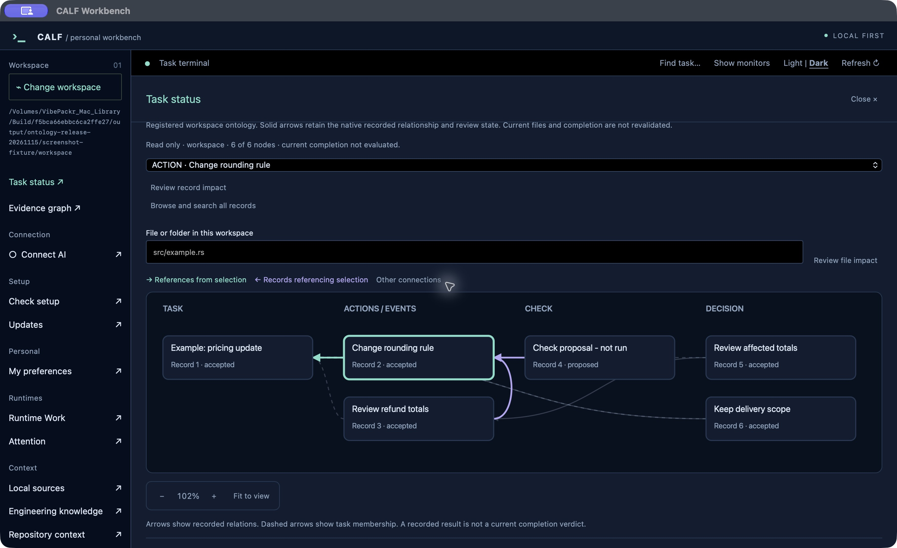
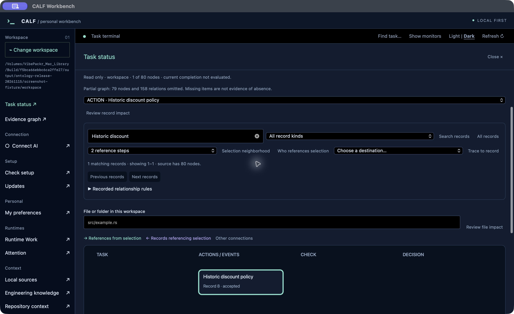
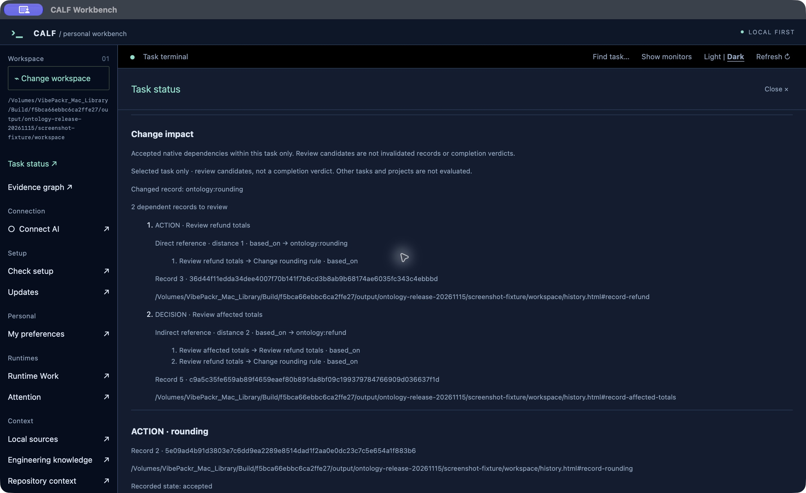

# Explore task evidence and change impact

Current guide: Harness **1.8.24** · Workbench **1.9.22** · SDK **0.2.11**.

[Install](INSTALL.md) · [Downloads](DOWNLOADS.md) · [한국어](ONTOLOGY_GUIDE_KR.md)

## Start with one record

Open **Evidence graph** in the sidebar, or press **Cmd/Ctrl+Shift+E**, then choose a **Registered task**. Select a node or use **Evidence record** to read its original text, sequence, hash and source. Zoom and **Fit to view** change the viewport only; they do not alter records or relationships.

The theme's teal highlights evidence referenced by the selection; violet highlights records referencing it. Other connections fade. Arrows and labels also convey direction. Dashed task membership remains separate from validation dependencies.

## Find older evidence

Choose **Browse and search all records**. Enter a title or record ID in **Search evidence records**, then select **Search records**. Filter by record kind, use **All records** to clear filters, and use **Previous records / Next records** to page. The default page contains 32 records. Returned, matched and source counts stay distinct.

Search covers all retained records of the selected task, including records outside the default recent graph. Open an older result to read its original evidence. If the source changes while browsing, refresh and query again; pages and details from different snapshots are rejected.

## Navigate references

Select a record, then use **Selection neighborhood** or **Who references selection**. **Reference depth** accepts 0–4 steps. Choose a **Reference path destination** and select **Trace to record** to find a recorded path within that depth. Navigation traverses references in either direction; displayed arrows preserve their original direction.

A missing path means none was found within the requested depth. It is not a causal judgment or evidence that external dependencies do not exist. Membership-only Workbench records explicitly report reference navigation unavailable. Proposed and retracted relations retain their recorded states during exploration.

## Review change impact

Select **Review record impact** to see direct and indirect dependents and the recorded dependency steps connecting each candidate to the selected evidence. Candidates use accepted, active dependencies within the selected task. They are review candidates, not invalidated records or current success/failure verdicts.

For a file or folder, enter its relative path in **Impact path relative to workspace** and select **Review file impact**. A historical aggregate scope digest cannot attribute a change to one individual file. Unrecorded dependencies, other tasks and other projects are not evaluated.

Each view displays at most 64 nodes and 256 edges; impact explanations show at most 16 steps, with omitted counts. Narrow the query or page through all evidence. **Recorded relationship rules** describes the core's record kinds and relationship restrictions. Browsing does not generate relations or alter rules or completion criteria.

## Preserve existing work

Queries are read-only and never execute, stop or restart tasks. Existing records, contracts, settings and pinned task runtimes remain intact. Host links read explicitly registered journals only; additional journals are not automatically merged. Response endings, historical results and current completion remain distinct. Older installed binaries and published releases are retained.

Actual macOS Workbench 1.9.21 · synthetic example · no checks executed.

Actual macOS Workbench 1.9.21 · synthetic example · no checks executed.

Actual macOS Workbench 1.9.21 · synthetic example · no checks executed.

## Actual model and constraints

See the [full specification](ONTOLOGY_MODEL.md) and [JSON](ONTOLOGY_MODEL.json) for all four stored types, common/variant properties, relation domain/range and enforcement points. Direct append and the review command both reject reviving a retracted record. Under Patch 2026-11-16 retains version numbers and the stored record format.
