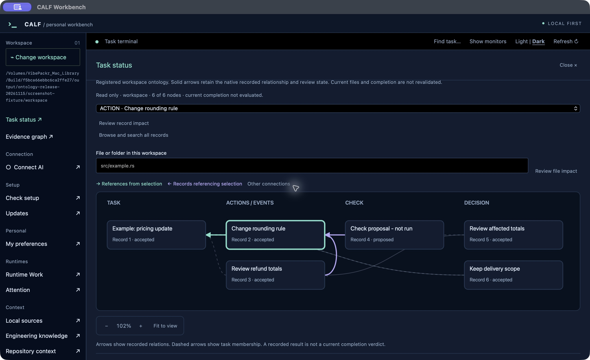
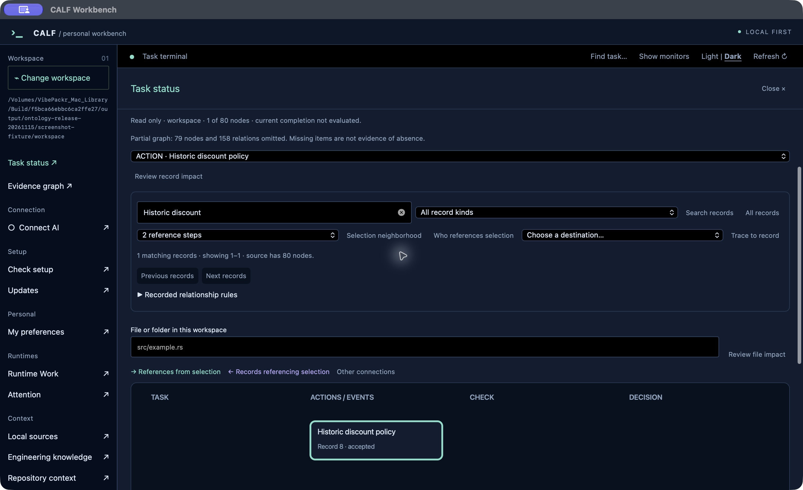
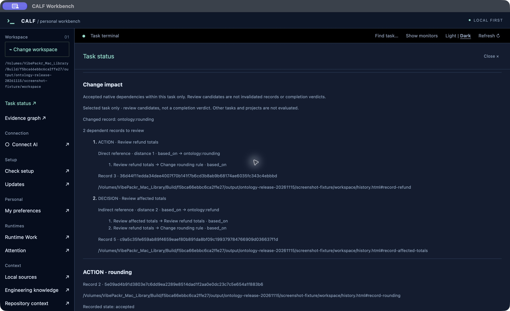

# 작업의 근거와 변경 영향 탐색

현재 안내: Harness **1.8.25** · Workbench **1.9.23** · SDK **0.2.11**.

[설치](INSTALL_KR.md) · [다운로드](DOWNLOADS.md) · [English](ONTOLOGY_GUIDE.md)

## 기록 하나의 근거부터 확인하기

왼쪽 **Evidence graph**를 열고 **Registered task**에서 작업을 선택하세요. 단축키는 **Cmd/Ctrl+Shift+E**입니다. 노드 또는 **Evidence record** 목록에서 기록을 선택하면 원문, 순서, 해시와 출처를 읽습니다. 확대·축소와 **Fit to view**는 화면 배율만 바꾸며 기록과 관계를 수정하지 않습니다.

선택한 기록이 참조하는 근거는 테마의 청록 계열, 선택한 기록을 참조하는 항목은 보라 계열로 강조하고 다른 선은 흐리게 표시합니다. 화살표와 설명도 방향을 함께 나타냅니다. 점선의 작업 소속 관계는 검증 의존성과 구별합니다.

## 오래된 기록 찾기

**Browse and search all records**를 누르세요. **Search evidence records**에 제목이나 기록 ID를 입력하고 **Search records**를 선택합니다. 기록 종류를 좁힐 수 있으며 **All records**는 검색 조건을 초기화합니다. **Previous records / Next records**로 페이지를 이동합니다. 기본 탐색 페이지는 32개이며 화면에 나온 수, 검색에 맞는 전체 수와 원본 수를 구분합니다.

검색은 선택한 작업의 전체 보존 기록을 대상으로 합니다. 기본 그래프의 최근 표시 범위에 없던 기록도 원문으로 확인할 수 있습니다. 검색 중 기록이 바뀌면 새로고침한 뒤 다시 조회하세요. 서로 다른 시점의 페이지나 원문을 섞어 보여주지 않습니다.

## 주변 관계와 역참조

기록을 선택하고 **Selection neighborhood**로 주변 관계를, **Who references selection**으로 이 기록을 참조하는 항목을 봅니다. **Reference depth**는 0–4단계입니다. **Reference path destination**에서 목적지를 선택한 뒤 **Trace to record**를 누르면 지정한 깊이 안의 기록된 참조 경로를 찾습니다. 경로 탐색은 양방향 참조를 따라가며 표시된 화살표는 원래 방향을 유지합니다.

이는 기록 탐색 기능입니다. 경로가 없다는 표시는 요청한 깊이 안에서 찾지 못했다는 뜻이며, 원인·결과나 모든 외부 의존성의 부재를 판정하지 않습니다. 소속 관계만 있는 Workbench 기록에는 참조 경로를 이용할 수 없다고 표시합니다. 제안·철회된 관계를 탐색하더라도 원래 상태를 유지합니다.

## 무엇을 다시 검토해야 하나요?

기록을 선택하고 **Review record impact**를 누릅니다. 직접 참조와 간접 참조를 구분하고, 각 후보가 선택 기록까지 이어지는 실제 근거 경로를 보여줍니다. 영향 후보는 같은 작업의 승인되고 유효한 의존성만 대상으로 합니다. 후보 표시가 기록 무효화나 현재 작업의 성공·실패를 뜻하지 않습니다.

파일·폴더는 **Impact path relative to workspace**에 상대 경로를 입력하고 **Review file impact**로 조회합니다. 과거 검사가 범위 전체의 지문만 보존한 경우 개별 파일 하나에 변경 원인을 귀속하지 않습니다. 기록되지 않은 관계와 다른 작업·프로젝트는 평가하지 않습니다.

한 번에 노드 64개·연결선 256개, 영향 설명은 16단계까지 표시하며 생략 수를 함께 알립니다. 전체 탐색과 페이지 이동으로 범위를 좁혀 보세요. **Recorded relationship rules**는 코어가 사용하는 기록 종류와 관계 제약을 설명합니다. 이 화면에서 새 관계를 자동 생성하거나 원래 규칙·완료 기준을 바꾸지 않습니다.

## 기존 작업과 데이터 보존

조회는 읽기 전용이며 작업을 실행·중단·재시작하지 않습니다. 원래 기록·계약·설정과 작업에 고정된 런타임을 유지합니다. 호스트 연결은 명시적으로 연결된 기록만 읽고, 추가 journal은 자동 병합하지 않습니다. 응답 종료·과거 검사 결과·현재 완료 판정을 구별합니다. 이전 버전의 실행 파일과 배포본도 보존합니다.

macOS Workbench 1.9.21 실제 화면 · 합성 예제 · 실제 검사 실행 결과 아님.

macOS Workbench 1.9.21 실제 화면 · 합성 예제 · 실제 검사 실행 결과 아님.

macOS Workbench 1.9.21 실제 화면 · 합성 예제 · 실제 검사 실행 결과 아님.

## 객체 모델과 제약의 실제 정의

저장 객체 네 타입, 공통·타입별 속성, 관계의 출발·도착 타입과 제약 적용 시점을 [전체 명세](ONTOLOGY_MODEL_KR.md)와 [JSON](ONTOLOGY_MODEL.json)에서 확인하세요. 직접 기록 추가와 검토 명령 모두 철회된 기록의 재승격을 차단합니다. Under Patch 2026-11-16이며 버전 번호와 기존 기록 형식은 유지합니다.
