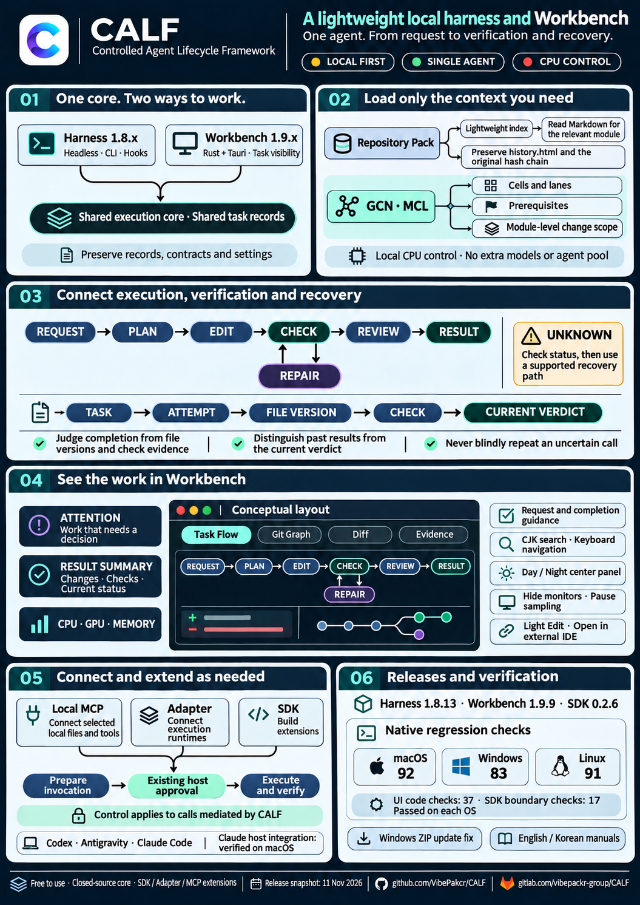

# CALF — Controlled Agent Lifecycle Framework

[한국어](README_KR.md) · [Downloads](DOWNLOADS.md) · [EN/KR manual](CALF_mannual.html)

CALF is a lightweight local harness and workbench for supervising one AI agent's work, from execution through checking and recovery. It links requests, actual changes and check evidence, while keeping failed and unfinished attempts in the record. Codex and Antigravity use native hooks; Claude CLI and the desktop app's local Code mode use a macOS adapter. Each host keeps its own account, model and approval policy.

## Less to keep track of on your first task

**Choose the folder, AI connection and result. CALF keeps the changes, check evidence and unfinished attempts together for review.**

Start with three choices: where the agent may work, your existing AI account, and the result, limits and checks. The first-task guide shows your selected setup and next step. **Use a request outline** only inserts three draft lines into an empty request. Fill them in before choosing Submit.

[Start with installation](INSTALL.md) · [First-task walkthrough](FIRST_TASK.md) · [EN/KR visual manual](CALF_mannual.html)

## Latest release · 2026-11-11

**Harness 1.8.13 · Workbench 1.9.9 · SDK 0.2.6**

This release brings Attention, result summaries, request guidance and a Day/Night center. Find CJK tasks with keyboard shortcuts, fold monitors in narrow windows and stop sampling hidden monitors. It also fixes Windows ZIP update preparation. See [VERIFICATION.json](VERIFICATION.json) for OS-specific evidence.

| Edition | Purpose |
|---|---|
| Harness 1.8.x | Headless core and hooks for an existing agent |
| Workbench 1.9.x | Rust + Tauri interface for the same execution and records |
| SDK | Python/Node clients, Local MCP and runtime adapters |

## CALF at a glance

A one-page overview of the shared core, scoped context, verification, recovery and extension boundaries. Release snapshot: 11 November 2026. The Workbench illustration is a conceptual layout.

  

[Full-size English infographic](calf-overview-en-20261111.png) · [한국어 인포그래픽](calf-overview-kr-20261111.png)

## Bind MCP tools to the work contract

Reviewed local MCP policies can run reads and create new candidates, with results tied to exact file versions and registered independent checks. Preparation is separate from approval. A lost response never triggers blind resubmission. Local recovery, when enabled in the original policy, checks the terminal receipt and candidate hash, then runs fresh checks. The same path is qualified for both editions on macOS, Windows and Linux.

The existing first-task guide remains available. Connect this extension only when needed; no resident service, extra model or agent pool is required. [MCP guide](MCP_TOOL_EVALUATION.md) · [SDK](SDK_README.md) · [Verification scope](VERIFICATION.json).

## See the decisions and results that need your attention

Attention gathers work that needs a decision. Result summaries show changed files, recorded checks and the current verdict. Request guidance helps you describe the result and how to check it while keeping your draft intact. Switch the center between Day and Night, find CJK tasks with keyboard shortcuts, and fold monitors in smaller windows. Folded monitors stop sampling system resources.

The Harness exposes the same read-only Attention query. Viewing or searching never runs or approves work, and completion rules and existing records remain intact. [Usage guide](WORKBENCH_CLARITY.md) · [Verification scope](VERIFICATION.json).

## What you can do

- Define a work contract and require checks tied to the current files.
- Follow Task Flow, Git Graph, Diff, Evidence and worker terminals.
- Use unittest, pytest, Cargo integration tests and node:test, with tools prepared in your project.
- Attach selected local references and connect other runtimes through MCP, SDK and adapters.
- Continue work from the same records home, retaining each older task's pinned runtime and remaining attempt budget.

Workbench **Task status** separates recorded completion from the current observer verdict. Even matching files can keep a current `UNKNOWN` if `LC_ALL` differs; CALF shows that difference. Details load when needed. No additional model, resident server or GPU control compute is required.

## Install and update

Choose macOS ARM64, Windows x64 or Linux x64 in [Downloads](DOWNLOADS.md), then extract into a new folder. Keep the complete existing records home (`CALF_WORK_HOME`), contracts, settings and older executables. Review hook updates in the same installation root and verify them in a new session. Publishing a release does not replace hooks in running sessions or add permanent allow rules.

[Host connections](HOST_CONNECTIONS.md) · [Claude guide](CLAUDE_CONNECTION.md) · [SDK guide](SDK_README.md) · [Status guide](STATUS_CONTEXT.md) · [Earlier releases](https://github.com/VibePakcr/CALF/releases)

The Claude host adapter is qualified on macOS only, separately from Windows/Linux core and SDK tests. macOS apps have an ad-hoc integrity signature and are not Apple-notarized. Windows packages have no publisher signature.

## See the Workbench

Actual Workbench 1.9.5 capture of the Claude check: saved success is separate from the current UNKNOWN caused by LC_ALL. Version 1.9.7 retains this status interface.

[Task Flow](workbench-task-flow.png) · [Diff](workbench-diff.png) · [Runtime Work](workbench-runtime.png): earlier actual 1.9.2 record views remain available. 

## Free use, closed core, official extensions

**CALF is free to use. Its core source is not publicly released.** A public download repository does not make the runtime open-source. Unauthorized reverse engineering, decompilation, disassembly, binary patching and alteration of the proprietary core are prohibited and may lead to legal action under applicable law. Free use does not grant rights to extract, modify or redistribute a modified core.

Build extensions through the provided **SDK, Adapter and MCP** interfaces. SDK source follows its separate integration license; the core implementation remains private. These restrictions concern the proprietary runtime, not your own project code or supported configuration and extension interfaces. Bundled third-party licenses and notices remain in force.

[Separate Repository extensions](https://github.com/VibePakcr/CALF-Extensions) · [Release notes](RELEASE-NOTES.md)
