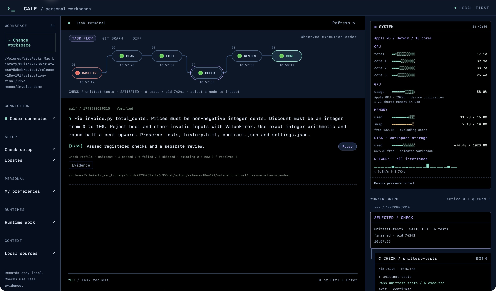

# CALF — Controlled Agent Lifecycle Framework

[English](README.md) · [한국어](README_KR.md)

**[Direct downloads · 바로 다운로드](DOWNLOADS.md)** — choose your OS without opening the Releases list. If an embedded browser reports a Releases error, use these links or open them in your browser.

CALF is a lightweight, local **AI execution harness and development workbench**. It connects an AI provider to a bounded work request, records execution, checks changes against registered requirements and file-version evidence, and retains failed or incomplete work for inspection and recovery.

The Harness is the native headless runtime: it can complement an existing Codex / Antigravity host through hooks or run tasks without a desktop window. The Workbench adds a Rust + Tauri interface for viewing and controlling the same core and new task records. It is a supervision workspace rather than a full IDE. CALF does not replace the connected host's approval or sandbox policy.


Codex and Antigravity are supported through focused **single-agent** workflows. CALF records and checks the work; host permissions remain in force.
## What is new — Harness 1.8.7 / Workbench 1.9.2 / SDK 0.2.1

- **Universal Work v1:** freeze a work contract, input snapshots and registered adapter identities; produce per-attempt file candidates; bind required checks and adoption to their exact manifest digest.
- **Runtime Work in Workbench:** import a contract, run or reconcile a registered runtime, inspect timestamped stages, artifacts and checks, cancel, recheck and explicitly adopt a verified version. Harness, SDK, MCP and Workbench use the same local records home.
- **Python, Node and local HTTP adapters:** real file-producing execution through one protocol. Dependency-free Python/Node SDK clients and a foreground stdio work MCP endpoint; read-only by default, control tools opt-in. Existing source-reader MCP stays separate.
- **Recovery:** unknown asynchronous submissions reserve the single execution slot and are queried using the original request ID. An explicit new attempt consumes the original budget. Previous candidates and adoption events remain. A timeout or exit 0 is not PASS.
- **Setup and updates:** first-run diagnostics, staged archive verification and retained originating runtimes. JavaScript/TypeScript node:test Check Profiles join Python unittest/pytest and bounded Cargo integration checks. No dependency installation or npm script execution.

The core remains local, lightweight and focused on a single agent. No model, multi-agent orchestration, embedding index or new resident service is added. Workbench loads only the selected runtime work; settled work is not continuously rehashed in the background.

## Free use, closed core, official extensions

**CALF is distributed free of charge for use. Its core source code is not publicly released.** A public download repository does not make CALF open-source or transfer rights to its implementation.

**Illegal or unauthorized alteration of CALF is prohibited.** The distribution policy does not permit reverse engineering, decompilation, disassembly, binary patching or modification of the proprietary CALF runtime. Violations may result in legal action under applicable law. Free use does not grant permission to extract, modify or redistribute a modified core.

Extensions are provided through official **SDK, adapter and MCP** interfaces, without modifying the core. **Available in this release:** bounded provider/check adapter specifications, the local JSON task interface and the source-reader MCP and optional-control Universal Work MCP. **Developer SDK 0.2.1 is now available separately:** [English guide](SDK_README.md), [한국어 안내](SDK_README_KR.md), and [download](https://github.com/VibePakcr/CALF/releases/download/sdk-v0.2.1/CALF-SDK-0.2.1.zip). Verified on macOS ARM64, Windows x64 and Linux x64. SDK source is supplied under its integration license; the CALF core remains private.

These restrictions concern the proprietary CALF implementation, not the user's own project code or supported configuration and extension interfaces. Bundled third-party components retain their own licenses and notices in `THIRD-PARTY-NOTICES.txt`.

| Edition | Version | Use |
|---|---|---|
| **Harness** | [1.8.7](https://github.com/VibePakcr/CALF/releases/tag/v1.8.7) | Native headless tasks and existing Codex / Antigravity hooks; no WebView |
| **Workbench** | [1.9.2](https://github.com/VibePakcr/CALF/releases/tag/v1.9.2) | Rust + Tauri desktop for the same execution core and new task records |

**Start with the illustrated [CALF_mannual.html](https://github.com/VibePakcr/CALF/releases/download/v1.9.2/CALF_mannual.html)** — download and open locally. It includes fixed top navigation and an **EN / KR** switch for the full manual, contents and screenshot captions. The same self-contained offline manual is inside every package. See [release notes](RELEASE-NOTES.md) and [SHA256SUMS](SHA256SUMS).

## Downloads

| Platform | Harness 1.8.7 | Workbench 1.9.2 |
|---|---|---|
| macOS Apple Silicon | [ZIP](https://github.com/VibePakcr/CALF/releases/download/v1.8.7/CALF-Harness-1.8.7-macos-arm64.zip) | [ZIP](https://github.com/VibePakcr/CALF/releases/download/v1.9.2/CALF-Workbench-1.9.2-macos-arm64.zip) |
| Windows x64 | [ZIP](https://github.com/VibePakcr/CALF/releases/download/v1.8.7/CALF-Harness-1.8.7-windows-x86_64.zip) | [ZIP](https://github.com/VibePakcr/CALF/releases/download/v1.9.2/CALF-Workbench-1.9.2-windows-x86_64.zip) |
| Linux x64 | [tar.gz](https://github.com/VibePakcr/CALF/releases/download/v1.8.7/CALF-Harness-1.8.7-linux-x86_64.tar.gz) | [tar.gz](https://github.com/VibePakcr/CALF/releases/download/v1.9.2/CALF-Workbench-1.9.2-linux-x86_64.tar.gz) |

Extract the complete package. Open **CALF Workbench.app**, `calf-terminal.exe`, or `./calf-terminal` for the desktop. Run `./calf --help` or `.\calf.exe --help` for Harness. The simple task workflow discovers supported unittest, pytest, Cargo or node:test checks; your project check tools remain separate prerequisites.

```sh
./calf task connect codex
./calf task run "/absolute/path/project" "Fix the bug and preserve the tests."
./calf task list
```

New headless tasks and Workbench share `CALF_WORK_HOME`. Existing 1.8.4 hook `history.html`, contracts and settings are preserved; legacy hook history is not automatically imported into the Workbench task list. Upgrade hooks using the same installation root and retain old versioned binaries.

Workbench provides Task Flow, Git Graph, Diff, Evidence, Light Edit, detected/manual external editors, worker terminals and explicit local references. Git observation is read-only. The interface defaults to English with Unicode/CJK text support.

These are early public **binary** releases, not a published core source repository. Registered evidence defines the scope of PASS; missing or stale evidence stays UNKNOWN. CALF does not replace host approval or sandbox policies. Remote AI use still sends the selected task context to the provider.

macOS 14+ ARM64; Windows x64 with WebView2 for Workbench; Linux glibc x64 with GTK 3 / WebKitGTK 4.1 for Workbench (Debian 13 tested). No Intel Mac, ARM64 Windows/Linux or musl build is included. macOS has an ad-hoc integrity signature, not Apple notarization; Windows has no publisher signature. Read the exact qualification limits in the release notes.

한국어 설명: [README_KR.md](README_KR.md).

Previous release: [CALF 1.8.4](https://github.com/VibePakcr/CALF/releases/tag/v1.8.4).

## Check Profiles and update-safe tasks

Both editions now use native Check Profiles for Python unittest, pytest and a bounded Cargo integration-test profile. CALF records pre-existing failures, separates test failures from missing tools or invalid evidence, and stops repeated attempts that make no measurable progress. A pre-existing failure is not a waiver: unresolved required checks cannot become PASS.

Python selection prefers the project's `.venv`, then `venv`, an explicitly active environment, and finally a bounded PATH probe. The selected interpreter and installed package metadata are recorded with the check. CALF does not install Python, pytest or project dependencies. A broken explicit environment is reported instead of silently selecting another one. Cargo currently covers a single package's integration tests with locked, offline execution; it does not claim workspace-wide, unit-test or doctest coverage.

New queued tasks retain a hash-verified copy of their originating runtime in the local records home. After an update, Resume uses that runtime and the original task's checks and evidence. Keep the complete records home and its `runtimes` directory. Old jobs without a provable runtime remain unresolved; they are not silently migrated. Direct advanced `calf run` states still require their original compatible runtime.

**SDK 0.2.1** adds `CalfClient.discover_checks()` and `Check.from_discovered()` to preserve native profile definitions in custom adapters. See [SDK guide](SDK_README.md), [protocol](SDK_PROTOCOL.md) and the included `examples/check_profiles.py`. The SDK provides small Python standard-library and dependency-free Node clients; it does not add an agent engine or background service.

[Update details / 업데이트 내용](UPDATE.md) · [Universal Work SDK / 범용 작업 SDK](SDK_WORK_PROTOCOL.md)

<!-- workbench-gallery:start -->
## See the Workbench

Real Workbench 1.9.2 captures; only OS title-bar chrome is cropped. [Capture context and verification scope](SHOWCASE.md).

### Task Flow · execution and evidence



Workbench 1.9.2 opens a retained, real Codex invoice example: three baseline failures resolved and six registered tests passed. The original run used Harness 1.8.6; this is a record-compatibility demonstration, not a new AI benchmark.

### Diff · the exact checked change


Before / After shows the recorded change and its matching CHECK receipt. Light Edit and external-editor controls remain separate from validation.

### Runtime Work · file artifacts across runtimes


A Python adapter produced a CJK document in this release. An independent exact-UTF-8 check passed; adoption is bound to that manifest. The same adopted record was verified after reopening Workbench.

<!-- workbench-gallery:end -->
