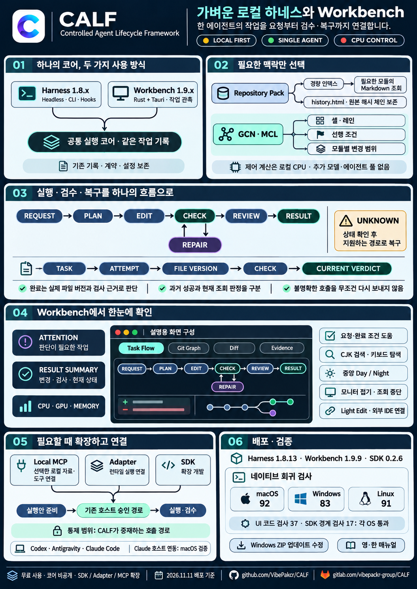

# CALF

**Controlled Agent Lifecycle Framework**

A lightweight, local-first harness and workbench for one AI agent. CALF keeps a task's request, changes, checks, evidence and recovery in one flow. It supports Codex, Antigravity and Claude Code, with a shared Rust core behind the headless Harness and Rust + Tauri Workbench.

**Free to use · Proprietary binary core · macOS / Windows / Linux**

[CALF website](https://calf.vibepackr.com/en/) · [Install](https://calf.vibepackr.com/manual/?lang=en#install) · [Download](https://calf.vibepackr.com/en/#downloads) · [Online manual](https://calf.vibepackr.com/manual/?lang=en) · [한국어](README_KR.md) · [Latest update](CURRENT_RELEASE.md)

**New to CALF?** Read the [overview](https://calf.vibepackr.com/en/), [download Workbench for your OS](https://calf.vibepackr.com/en/#downloads), then follow the [installation and first-task guide](https://calf.vibepackr.com/manual/?lang=en#install).

## Latest release

Harness **1.8.19** · Workbench **1.9.16** · SDK **0.2.11**

The first task connects workspace selection, your existing AI connection, request, check readiness and result review. Interface text uses system type; paths, code and execution records retain monospace type. **Current / Recorded / Next** separate current evidence, retained results and the next action. The app icon keeps its original artwork with rounded white-tile corners.

[New screen guide](UI_GUIDE.md) · [Changes](RELEASE-NOTES.md) · [Earlier releases — Legacy](LEGACY.md)

## How it helps

- **Delegate one bounded task.** Keep a single-agent workflow and the host's existing account and approval rules.
- **See the actual work.** Task Flow, Git Graph, Diff, worker output and result summaries connect the request to the files and check receipts.
- **Require evidence.** Registered checks must match the current files and execution context. A normal tool exit or an AI's claim is not completion.
- **Continue safely.** Retained attempts, explicit resume, protected inputs and recoverable artifact quarantine help you continue without discarding prior records.
- **Use focused local context.** Repository Intelligence and engineering references use bounded CPU queries. No extra agent, local model or background indexing service is required.
- **Connect the tools you choose.** Local MCP, adapters and the SDK extend the controlled execution path. VibePackr is optional and CALF works independently.

The optional local model transport remains a preview. Model-list connection is separate from a completed task; read the [Ollama/MLX qualification limits](LOCAL_MODELS.md).

## Harness or Workbench

Use **Harness 1.8.x** for headless CLI, host hooks and MCP integrations. Open **Workbench 1.9.x** against the same CALF data home to inspect those records. Workbench adds a desktop view; it does not introduce a second completion engine. Keep older task runtimes and records when updating.

## First task

The same release executable is shown with separate example records. See [Windows, Linux and result review](UI_GUIDE.md). Machine-wide monitor values are not a CALF performance measurement.

## Guides and extensions

[Getting started](INSTALL.md) · [Host connections](HOST_CONNECTIONS.md) · [First task](FIRST_TASK.md) · [Repository Intelligence](REPOSITORY_BUILTIN.md) · [Artifacts](ARTIFACT_LIFECYCLE.md) · [MCP tool evaluation](MCP_TOOL_EVALUATION.md) · [SDK](SDK_README.md) · [Verification scope](VERIFICATION.json)

Repository Intelligence is built into the core. The separate [CALF Extensions](https://github.com/VibePakcr/CALF-Extensions) repository contains the FFmpeg extension; it is optional.

## Distribution terms

CALF is free to use. Its core source is not published and CALF is not an open-source licence grant. Unauthorised modification, tampering, reverse engineering or redistribution may lead to legal action under the applicable terms and law. Use the separately provided SDK, adapters and MCP interfaces for extensions; their own licence applies. See the licence files supplied with each package. Connected AI services retain their own fees and terms.

## Architecture overview

## IDE connection / IDE 연결

[CALF Connect installation](https://github.com/VibePakcr/CALF-Extensions/blob/main/ide-connect/INSTALL.md) · [한국어 설치](https://github.com/VibePakcr/CALF-Extensions/blob/main/ide-connect/INSTALL_KR.md) · [Actual-screen manual / 화면 매뉴얼](https://github.com/VibePakcr/CALF-Extensions/blob/main/ide-connect/MANUAL_KR.md). Optional local-install files for VS Code, Cursor, PyCharm and Antigravity IDE; actual flows observed on three operating systems. No task is automatically submitted.
