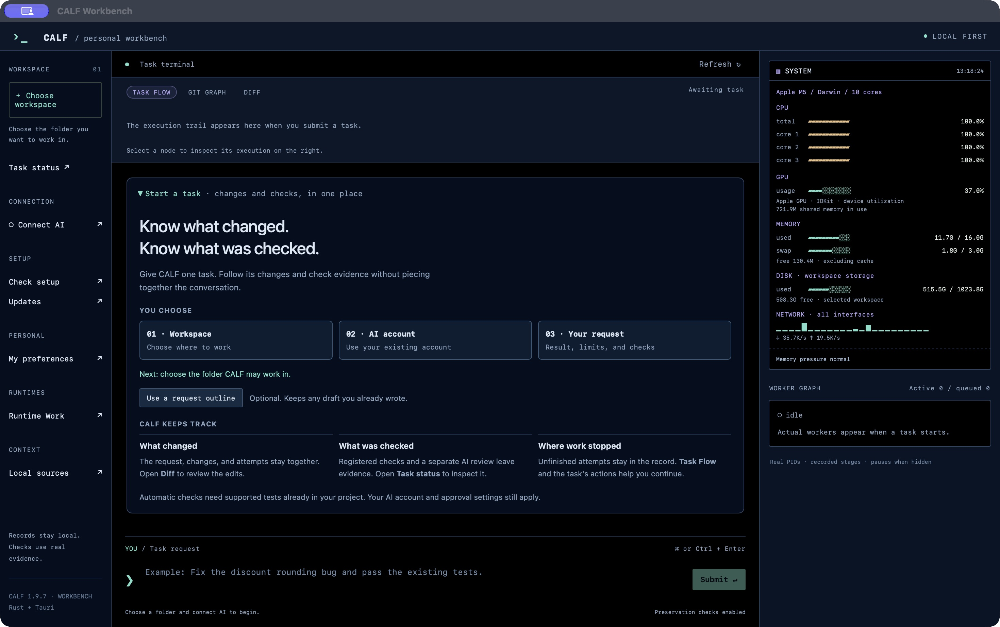
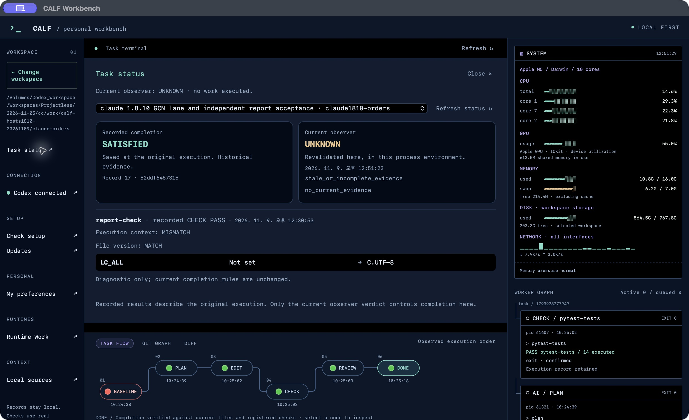
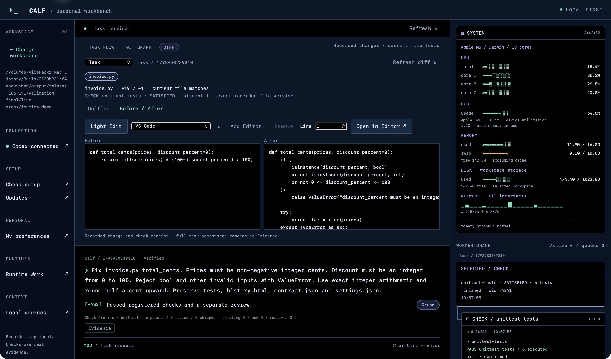
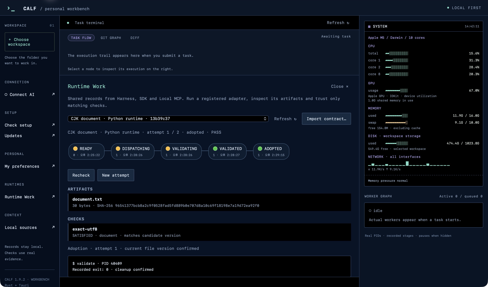

# CALF — Controlled Agent Lifecycle Framework

[English](README.md) · [다운로드](DOWNLOADS.md) · [영·한 사용 매뉴얼](CALF_mannual.html)

CALF는 AI 에이전트 하나에게 맡긴 작업을 실행부터 검사·복구까지 감독하는 경량 로컬 도구입니다. 요청과 실제 변경, 검사 근거를 연결하고 실패하거나 미완료인 시도도 기록에 남깁니다. Codex·Antigravity는 네이티브 훅으로, Claude CLI와 앱의 로컬 Code 모드는 macOS 어댑터로 연결합니다. 각 호스트의 계정·모델·승인 정책은 유지합니다.

## 첫 작업에서 덜 신경 쓸 일

**폴더·AI 연결·원하는 결과를 정하면, CALF에서 변경 내용과 검사 근거, 끝나지 않은 시도를 함께 확인할 수 있습니다.**

처음에는 세 가지만 준비하세요. 작업할 폴더를 선택하고, 기존 AI 계정을 연결하고, 결과·유지할 것·확인 방법을 적습니다. 첫 작업 안내가 현재 선택 상태와 다음 단계를 보여줍니다. **Use a request outline**은 빈 입력창에 세 줄의 초안만 넣습니다. 내용을 채운 뒤 Submit을 누르세요.

[설치부터 시작](INSTALL_KR.md) · [첫 작업 단계별 안내](FIRST_TASK_KR.md) · [영·한 화면 매뉴얼](CALF_mannual.html)

## 최신 배포 · 2026-11-10

**Harness 1.8.11 · Workbench 1.9.7 · SDK 0.2.4**

Workbench에 접고 다시 열 수 있는 첫 작업 안내를 추가했습니다. 기존 초안은 덮어쓰지 않으며, 설정 진단은 필요할 때 Check setup으로 엽니다. 연결이 저장됐다는 표시는 실시간 인증 성공이나 실행 승인을 뜻하지 않습니다. 하네스·SDK 기존 릴리즈는 유지합니다. [검증 범위](VERIFICATION.json)를 확인하세요.

| 제품 | 용도 |
|---|---|
| 하네스 1.8.x | 창 없이 실행하는 코어와 기존 에이전트 훅 |
| Workbench 1.9.x | 같은 실행·기록 체계에 Rust + Tauri 작업 화면 추가 |
| SDK | Python·Node, Local MCP와 범용 어댑터를 통한 확장 |

## 할 수 있는 일

- 작업 계약과 검사 기준을 정하고 현재 파일과 검사 증거가 맞는지 확인합니다.
- Task Flow, Git Graph, Diff, Evidence와 워커 터미널로 진행 상황을 봅니다.
- unittest·pytest·Cargo 통합 검사·node:test를 사용하며 필요한 도구는 프로젝트에서 준비합니다.
- 선택한 로컬 참조만 다음 작업에 첨부하고 MCP·SDK·어댑터로 다른 런타임을 연결합니다.
- 같은 기록 위치에서 작업을 이어갑니다. 이전 작업에 고정된 실행 파일과 남은 시도 예산도 유지합니다.

Workbench **Task status**는 저장된 완료와 현재 조회 판정을 나눠 보여줍니다. 파일이 같아도 `LC_ALL`이 다르면 현재 `UNKNOWN`을 유지하며 차이를 표시합니다. 상세 정보는 필요할 때 읽습니다. 추가 모델·상시 서버·GPU 제어 연산은 필요하지 않습니다.

## 설치와 업데이트

[다운로드](DOWNLOADS.md)에서 macOS ARM64, Windows x64, Linux x64용 제품을 선택하고 새 폴더에 압축을 푸세요. 기존 기록 위치(`CALF_WORK_HOME`)·계약·설정과 이전 실행 파일은 보관하세요. 호스트 훅은 같은 설치 위치에서 검토 후 업데이트하고 새 세션으로 확인합니다. 이미 열린 세션을 강제로 바꾸거나 영구 허용 규칙을 추가하지 않습니다.

[호스트 연결](HOST_CONNECTIONS_KR.md) · [Claude 안내](CLAUDE_CONNECTION_KR.md) · [SDK 안내](SDK_README_KR.md) · [상태 조회](STATUS_CONTEXT_KR.md) · [이전 릴리즈](https://github.com/VibePakcr/CALF/releases)

Claude 호스트 어댑터는 macOS에서만 검증했습니다. Windows·Linux용 코어·SDK 검증과는 별개입니다. macOS 앱은 무결성 확인용 임시 서명본이며 Apple 공증본은 아닙니다. Windows 패키지에는 배포자 서명이 없습니다.

## Workbench 화면

실제 Workbench 1.9.5에서 Claude 검사 기록을 조회한 화면입니다. 저장된 통과와 LC_ALL이 다른 현재 조회의 UNKNOWN을 구분합니다. 1.9.7에도 같은 상태 화면을 제공합니다.

[Task Flow](workbench-task-flow.png) · [Diff](workbench-diff.png) · [Runtime Work](workbench-runtime.png): 이전 1.9.2의 실제 기록 화면도 보존했습니다. 

## 무료 사용 · 비공개 코어 · 공식 확장

**CALF는 무료로 사용할 수 있지만 코어 소스는 공개하지 않습니다.** 공개 다운로드 저장소가 코어를 오픈소스로 제공한다는 뜻은 아닙니다. 코어의 무단 리버스 엔지니어링·디컴파일·디스어셈블·바이너리 패치·개변조를 허용하지 않으며, 위반 시 관계 법령에 따른 법적 제재를 받을 수 있습니다. 무료 사용은 코어 수정·추출·개변조본 재배포 권한을 포함하지 않습니다.

확장은 제공되는 **SDK·Adapter·MCP** 인터페이스로 구현하세요. SDK 소스는 별도의 통합 라이선스를 따르며 코어 구현은 비공개로 유지합니다. 이 제한은 사용자가 소유한 프로젝트 코드나 지원되는 설정·확장 인터페이스를 제한하려는 것이 아닙니다. 함께 배포하는 외부 구성요소의 라이선스와 고지는 유지합니다.

[별도 Repository 확장팩](https://github.com/VibePakcr/CALF-Extensions) · [릴리즈 변경사항](RELEASE-NOTES.md)
