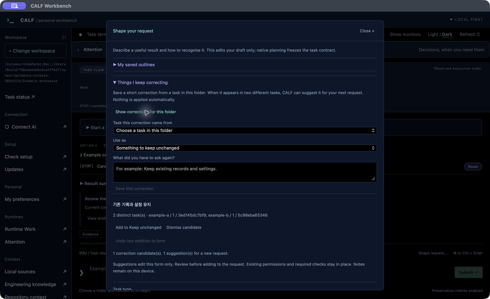
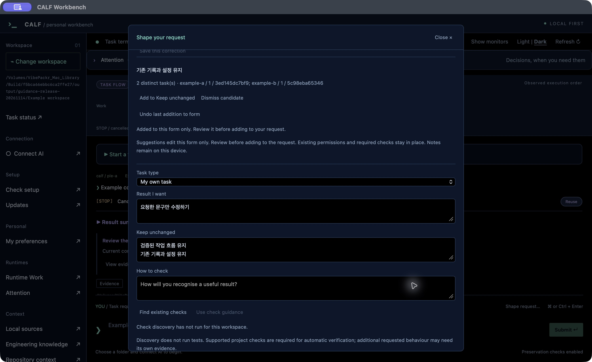
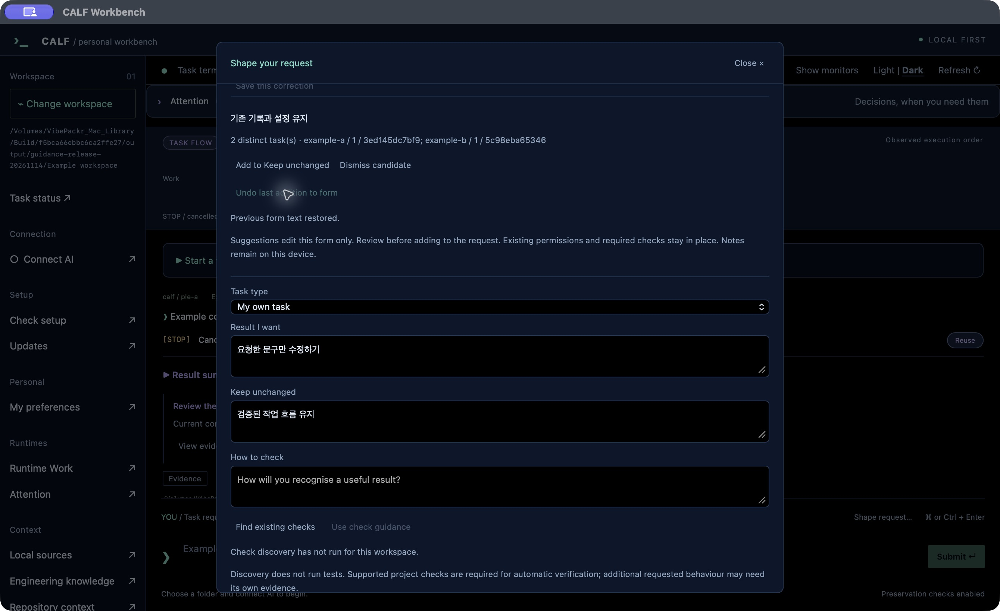

# Stop explaining the same correction again

[Install](INSTALL.md) · [Screen guide](UI_GUIDE.md) · [한국어](REQUEST_GUIDANCE_KR.md)

If you keep adding “leave my settings alone” to requests, save that correction and bring it into the next draft when it helps. Read the suggestion and choose whether to add it.

## Save a correction

1. Open **Shape request…** beside the request box, then expand **Things I keep correcting**.
2. Choose **Show corrections for this folder** to load this folder’s list.
3. Pick **Task this correction came from**, then choose what it describes under **Use as**: something to preserve or a way to check the result.
4. Enter a short correction and choose **Save this correction**.

The same wording and purpose must be saved against two different tasks in the same folder before it becomes a suggestion. Saving it again for one task does not increase the count. CALF does not read conversations automatically or merge similar wording.

## Add it to the next draft

Choose **Add to Keep unchanged** or **Add to How to check**. CALF appends it after your existing text. Review the form, then choose **Add to request** to put it in the request draft. Only **Submit** starts a task.

## Undo an addition

**Undo last addition to form** restores that field’s previous text. If you have edited the field since adding the suggestion, undo leaves your new edits alone. **Undo helper text** reverses the later addition to the request draft.

The title and **Close ×** stay at the top while the contents scroll. Closing the dialog or pressing Escape keeps the form and does not submit work.

## What to expect

Notes stay on this device and are separated by folder. A suggestion does not change an existing task’s contract, permissions or required checks, or become a global rule automatically. **Dismiss candidate** removes it from the suggestion list while retaining its original records.

The pictures show the actual notarized macOS Workbench 1.9.18 app with separate example records. No AI work or user material is shown. The same feature was exercised in actual Windows and Debian apps; these pictures are macOS captures.
