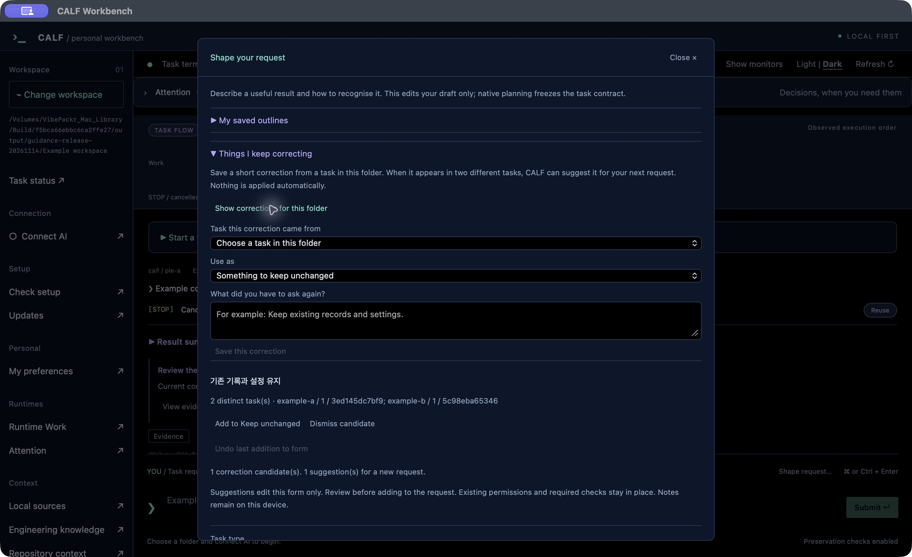
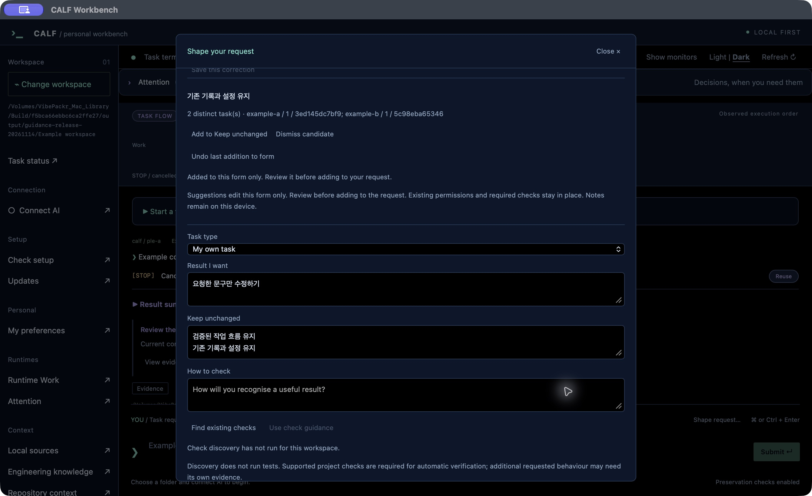
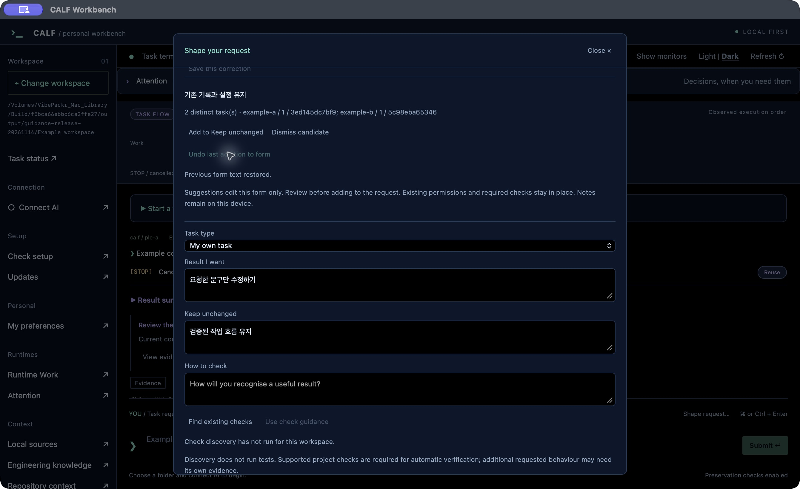

# 같은 수정을 다시 설명하지 않으려면

[설치](INSTALL_KR.md) · [화면 안내](UI_GUIDE_KR.md) · [English](REQUEST_GUIDANCE.md)

자꾸 “기존 설정은 그대로 두세요”라고 덧붙이게 된다면, 그 내용을 다음 요청에서 꺼내 쓸 수 있습니다. CALF가 제안한 문구를 읽고 직접 추가하세요.

## 수정 사항 남기기

1. 요청 입력란 옆 **Shape request…**를 열고 **Things I keep correcting**을 펼칩니다.
2. **Show corrections for this folder**로 이 폴더의 목록을 불러옵니다.
3. **Task this correction came from**에서 작업을 고르고, **Use as**에서 유지할 내용 또는 확인 방법을 선택합니다.
4. 반복해서 요청했던 짧은 문구를 적고 **Save this correction**을 누릅니다.

같은 폴더의 서로 다른 두 작업에 같은 문구와 용도를 남기면 다음 요청에 쓸 제안으로 나타납니다. 같은 작업에서 여러 번 저장해도 횟수는 늘지 않습니다. 대화를 자동으로 읽거나 비슷한 문구를 합치지는 않습니다.

## 다음 초안에 넣기

**Add to Keep unchanged** 또는 **Add to How to check**를 누르면 원래 적은 내용 뒤에 제안이 추가됩니다. 내용을 확인한 뒤 **Add to request**로 요청 초안에 옮기세요. 실제 작업 시작은 **Submit**을 눌렀을 때입니다.

## 잘못 넣었다면 되돌리기

**Undo last addition to form**은 방금 제안을 넣은 입력란을 이전 내용으로 돌립니다. 추가 후 그 입력란을 직접 고쳤다면 새 편집을 덮어쓰지 않습니다. 요청 초안으로 옮긴 내용은 **Undo helper text**로 되돌릴 수 있습니다.

제목과 **Close ×**는 본문을 스크롤해도 위에 남습니다. 닫거나 Escape를 눌러도 작성한 양식은 유지되며 작업이 제출되지는 않습니다.

## 기억해 둘 점

기록은 이 장치에 남고 폴더별로 구분됩니다. 제안이 기존 작업의 계약·권한·필수 검사를 바꾸거나 전역 규칙으로 자동 적용되지는 않습니다. **Dismiss candidate**는 제안 목록에서만 제외하며 원래 기록을 지우지 않습니다.

사진은 Workbench 1.9.18의 공증된 실제 macOS 앱을 별도 예제 기록으로 연 화면입니다. AI 작업이나 사용자 자료는 포함하지 않았습니다. 같은 기능의 Windows·Debian 실제 앱 동작도 확인했으며, 이 사진은 macOS 화면입니다.
