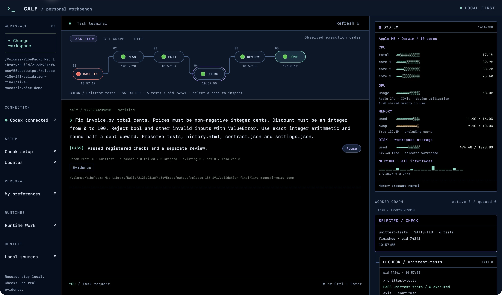
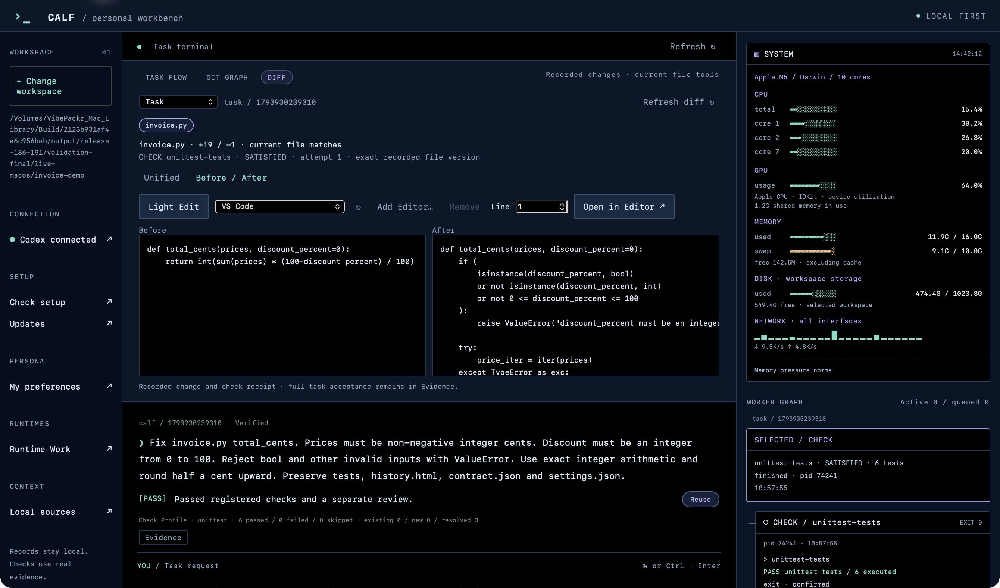
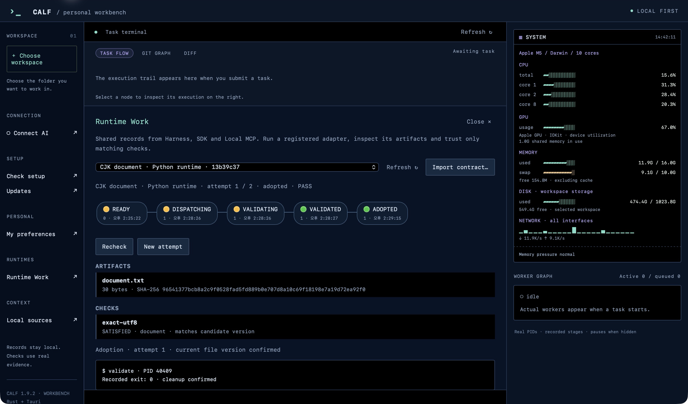

# CALF Workbench 1.9.2 · Screenshots / 실제 화면

Actual macOS app captures. Only the macOS title bar is omitted; application pixels are unchanged. System metrics show the whole computer, not CALF memory usage.

실제 macOS 앱 캡처입니다. macOS 제목 표시줄만 제외했으며 앱 픽셀은 변경하지 않았습니다. 시스템 수치는 CALF 단독 사용량이 아닌 컴퓨터 전체의 사용량입니다.

## Task Flow · execution and evidence / Task Flow · 실행과 근거

Workbench 1.9.2 opens a retained, real Codex invoice example: three baseline failures resolved and six registered tests passed. The original run used Harness 1.8.6; this is a record-compatibility demonstration, not a new AI benchmark.

Workbench 1.9.2에서 보존된 실제 Codex invoice 작업을 열었습니다. 기존 실패 3건을 해결하고 등록 검사 6개를 통과한 기록입니다. 원래 실행은 Harness 1.8.6이며, 이 화면은 새 AI 실행 결과가 아니라 이전 기록을 열 수 있는지 확인한 예시입니다.

## Diff · the exact checked change / Diff · 검사한 변경 확인

Before / After shows the recorded change and its matching CHECK receipt. Light Edit and external-editor controls remain separate from validation.

Before / After에서 실제 변경과 같은 파일 버전의 CHECK 영수증을 확인합니다. Light Edit와 외부 에디터 호출은 검수 결과와 구분됩니다.

## Runtime Work · file artifacts across runtimes / Runtime Work · 런타임을 잇는 파일 산출물

A Python adapter produced a CJK document in the 1.9.2 capture. An independent exact-UTF-8 check passed; adoption is bound to that manifest. The same adopted record was verified after reopening Workbench.

1.9.2 화면에서 Python Adapter가 CJK 문서를 생성했습니다. 생성된 문서의 UTF-8 내용을 별도로 검사하고, 검사한 파일 목록의 해시를 채택 기록에 남겼으며, Workbench를 다시 열어 같은 채택 기록이 남아 있는지 확인했습니다.

