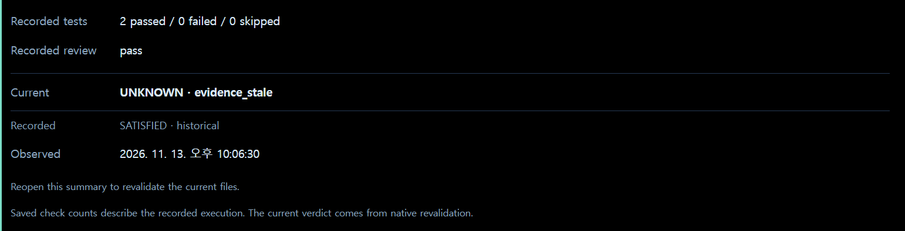

# Workbench 1.9.26 screen guide
## Workbench 1.9.26 — usable task space and interactive evidence graphs

Task observations and task records now have separate scrolling areas. **Start a task** and the execution records keep their own space when switching between Task Flow, Git Graph and Diff. Drag the divider to adjust the split, or focus it and use arrow keys; Enter restores the default.

In **Evidence graph**, drag a node to rearrange it, drag the background or scroll to move around, and use the zoom controls or Ctrl/⌘ + wheel. **Fit to view** fits the graph; **Reset layout** restores the original arrangement. Shift + arrow keys moves a focused node. These are temporary view changes: recorded evidence, relationships and completion decisions are unchanged.

Git Graph continues to show local commits and branches. It displays merges, local changes, conflicts, detached HEAD and tracking counts from local refs, with at most 20 recent commits. It does not fetch or modify the repository. A file dependency graph is a separate view and is not part of this update.

Update from 1.9.25 through Updates, or extract 1.9.26 into a new folder while keeping the existing records home. Earlier installations and rollback remain available. Harness 1.8.25 and SDK 0.2.11 are unchanged. [Update guide](UPDATE.md) · [Online manual](https://calf.vibepackr.com/manual/?lang=en#workspace-graphs).

## Workbench 1.9.25 — a smaller Updates view

Updates shows the **running version**, at most one **verified newer prepared update**, and the **verified previous version** for rollback. A window still running an older version says so separately from the selected version. An update candidate must be newer than both.

Older installations move into collapsed **Retained versions**, grouped by version without repeated activation buttons. They are kept on disk. Failed candidate or rollback verification disables that action and explains the problem. Existing native activation and rollback verify the selected bytes again when used.

Nothing downloads or changes versions automatically. Records, contracts, settings, audit history and pinned task runtimes remain intact. The retained catalogue keeps its existing bound of 32 local entries. Harness 1.8.25 and SDK 0.2.11 are unchanged.

Update from 1.9.24 through Updates or extract 1.9.25 into a new folder with your existing records home. [Update guide](UPDATE.md) · [Online manual](https://calf.vibepackr.com/manual/?lang=en#update-view).

## Workbench 1.9.24 — follow work and review interruptions

Switch between **Flow** and **History** for the same recent verified steps. The task request, recorded state and available state explanation stay together. Select a step to inspect its record and operation details; use **Task evidence** for current validation.

**Review requests** opens Attention. **Needs review**, **Observation gaps** and **All observed** filter the same bounded native observation. Cards separate the historical outcome from current completion, show freshness, and expose the recorded evidence reference. Open a task to inspect it before taking an existing review action.

This is a view over existing records. It adds no execution engine, task database, automatic approval, remote approval or host-task control. Earlier records and pinned runtimes remain intact. Harness 1.8.25 and SDK 0.2.11 are unchanged.

Upgrade from Workbench 1.9.23 through Updates, or extract 1.9.24 into a new folder and keep your existing records home. [Screen guide](WORK_STATE_VIEW.md) · [Online manual](https://calf.vibepackr.com/manual/?lang=en#work-state).

## 1.8.25 / 1.9.23 — incident evaluation, adversarial review and event resume

Historical incident packets exclude answers and future evidence; scores separate diagnosis from handoff usefulness. Adversarial review binds support, counterexamples and alternatives to actual current native CHECKs. Opt-in local events resume one bound managed task, reject duplicate/stale events and retain uncertain interrupted execution for review. Existing records, contracts, settings and pinned task runtimes remain intact.

Use `calf evaluation` and `calf events` through the CLI or common API. [Usage and fields](WORKFLOW_HARDENING.md) · [Online manual](https://calf.vibepackr.com/manual/?lang=en#workflow-hardening). SDK 0.2.11 is unchanged.

Upgrade from Workbench 1.9.22 through Updates or extract 1.9.23 into a new folder. Keep the original records home and pinned task runtimes. Linked host tasks continue in their original host.

## Workbench 1.9.22 — connected task status

Open a card under Connected tasks to read that exact host task. You can do this before choosing a workspace. Refresh status reads the same selected task again.

If the task is missing from a bounded or recently changed task list, Workbench retains its identity and requests that task directly. If its link is no longer readable, the view shows an error instead of displaying another task’s result. Check the existing host connection, then refresh; no restart is needed for this read-only view.

“Response ended” describes a recorded host event. It does not establish process liveness or completion of the whole task. UNKNOWN stays unknown when current completion has not been evaluated.

Sidebar utility panels occupy the central work area. Close or Esc returns to the task view. Switching between panels retains an unsaved preferences draft; Save preferences is the explicit save action.

Upgrade from Workbench 1.9.21 through Updates, or download 1.9.22 and extract it to a new folder. Keep your existing records folder, contracts, preferences and pinned task runtimes. Preparing the update leaves the current window running. Existing linked tasks continue in their original host.

[한국어](UI_GUIDE_KR.md) · [Install](INSTALL.md) · [First task](FIRST_TASK.md)

## Ontology evidence exploration

Current guide: Harness **1.8.25** · Workbench **1.9.26** · SDK **0.2.11**.

Read-only task evidence graphs, historical search and paging, reference navigation, and direct/indirect impact explanations. Existing records, contracts, settings and task execution are preserved. [Guide](ONTOLOGY_GUIDE.md)

## 1.9.20 connected tasks

Select an explicitly linked CALF host journal in **Connected tasks**. **Task status** separates recorded evidence and current observation. Refresh and latest-response tracking do not control host execution. [Guide](HOST_TASKS_PATCH.md). Earlier pictures below retain their version labels.

## 1.9.19 views and task status

Utility views use the center. Close or Escape returns while retaining drafts. In **Task status**, choose a retained task for the folder and read recorded and current observations separately. [Patch guide](UI_STATUS_PATCH.md). Earlier pictures below retain their version labels.

## Add and undo a repeated correction

Open **Shape request… → Things I keep correcting**. Load suggestions, append one after your text, or undo it. [Follow the steps](REQUEST_GUIDANCE.md).

The first-task and result pictures below remain examples from the earlier 1.9.16 release.

## Start with the next action

Read the next step inside **Start a task**, then follow workspace, AI connection, request, check readiness and results. System type distinguishes instructions from monospace paths, commands and records.

## Read the result

| Label | Meaning |
| --- | --- |
| Current | Native verdict for current files and execution context |
| Recorded | Historical result retained from that run |
| Next | The required evidence review, recheck or other next action |

A past SATISFIED remains historical when current evidence is stale and UNKNOWN. A click, an AI completion claim or command exit 0 is not completion proof. Attention exposes a human decision reason and next action without approving or rerunning work.

## Presentation and preservation

Light/Dark changes the center palette. Show/Hide monitors changes visibility. Unsubmitted CJK drafts remain intact. The original icon artwork is retained; the white tile has an 18%-of-side corner radius.

These are actual windows using release executables with separate example records. The result example is a synthetic technical check, not a published customer task or fresh AI delivery. VERIFICATION.json separates OS screen checks, UI regressions and final package tests. No human-time, token-saving or long-duration performance measurement is claimed.

## Add personal material

In **Engineering knowledge → Add a material folder…**, choose Markdown or text files once. CALF checks and indexes them, then connects new tasks automatically. Adding material does not call AI; starting a later AI task sends selected excerpts to the connected provider. Existing selections and original files are retained. [Coverage and use](ENGINEERING_KNOWLEDGE.md).
