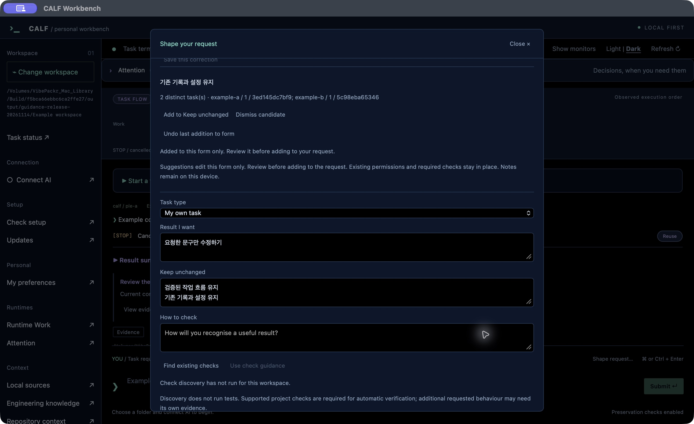
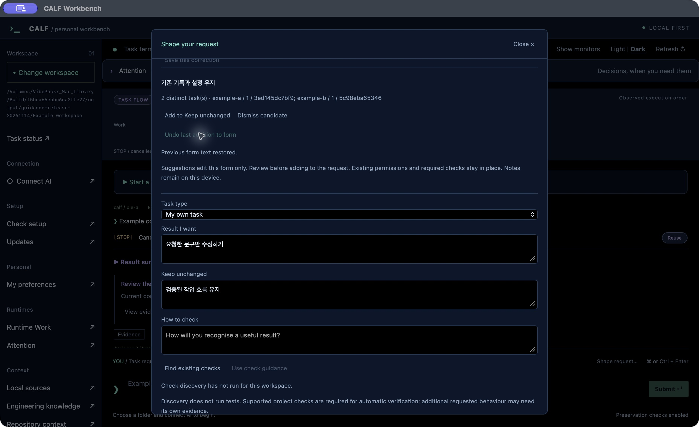
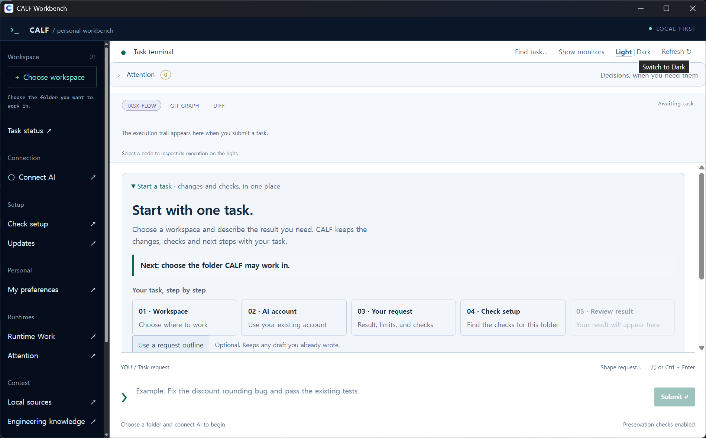
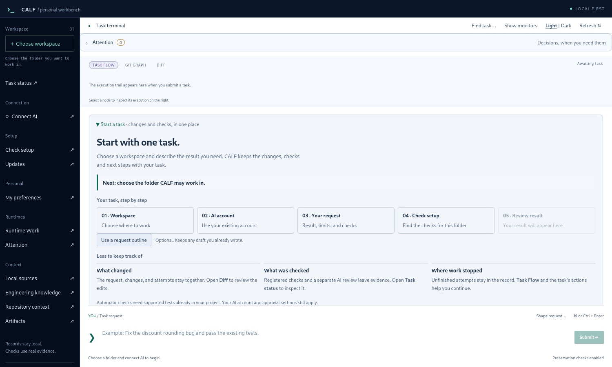
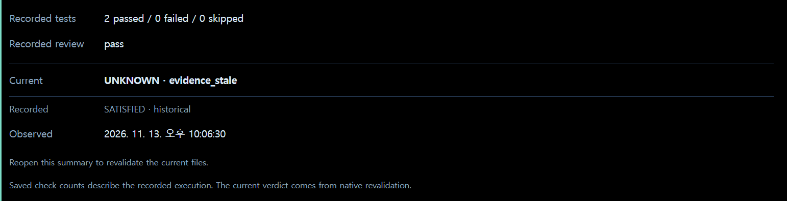

# Workbench 1.9.18 screen guide

[한국어](UI_GUIDE_KR.md) · [Install](INSTALL.md) · [First task](FIRST_TASK.md)

## Add and undo a repeated correction

Open **Shape request… → Things I keep correcting**. Load suggestions, append one after your text, or undo it. [Follow the steps](REQUEST_GUIDANCE.md).

The first-task and result pictures below remain examples from the earlier 1.9.16 release.

## Start with the next action

Read the next step inside **Start a task**, then follow workspace, AI connection, request, check readiness and results. System type distinguishes instructions from monospace paths, commands and records.

## Read the result

| Label | Meaning |
| --- | --- |
| Current | Native verdict for current files and execution context |
| Recorded | Historical result retained from that run |
| Next | The required evidence review, recheck or other next action |

A past SATISFIED remains historical when current evidence is stale and UNKNOWN. A click, an AI completion claim or command exit 0 is not completion proof. Attention exposes a human decision reason and next action without approving or rerunning work.

## Presentation and preservation

Light/Dark changes the center palette. Show/Hide monitors changes visibility. Unsubmitted CJK drafts remain intact. The original icon artwork is retained; the white tile has an 18%-of-side corner radius.

These are actual windows using release executables with separate example records. The result example is a synthetic technical check, not a published customer task or fresh AI delivery. VERIFICATION.json separates OS screen checks, UI regressions and final package tests. No human-time, token-saving or long-duration performance measurement is claimed.

## Add personal material

In **Engineering knowledge → Add a material folder…**, choose Markdown or text files once. CALF checks and indexes them, then connects new tasks automatically. Adding material does not call AI; starting a later AI task sends selected excerpts to the connected provider. Existing selections and original files are retained. [Coverage and use](ENGINEERING_KNOWLEDGE.md).
