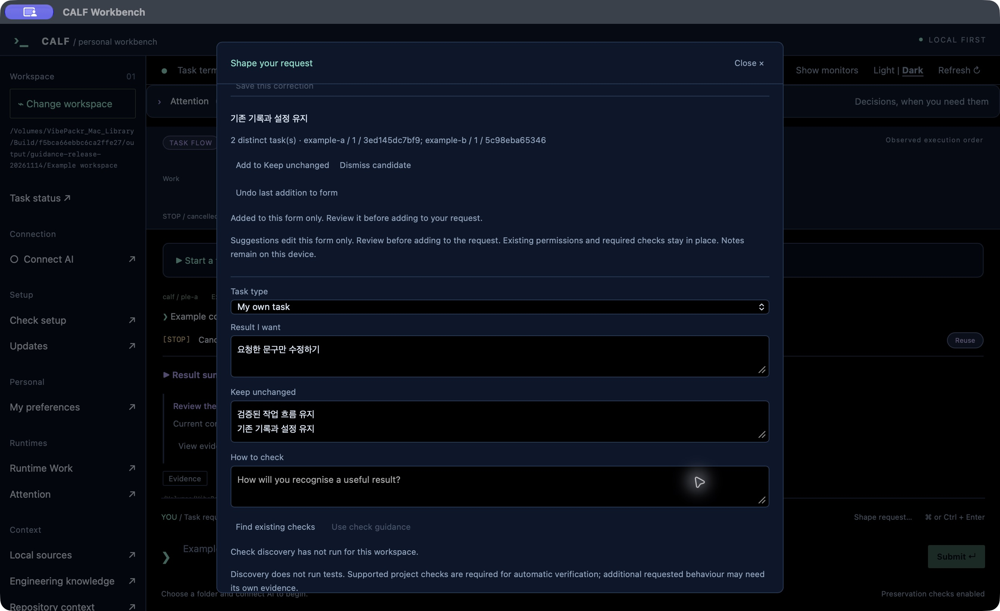
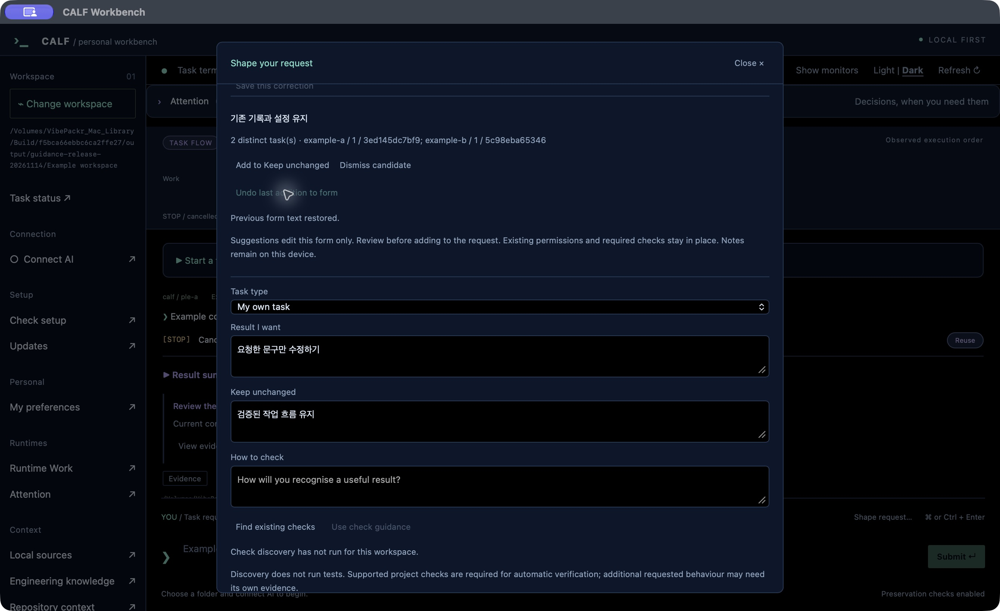
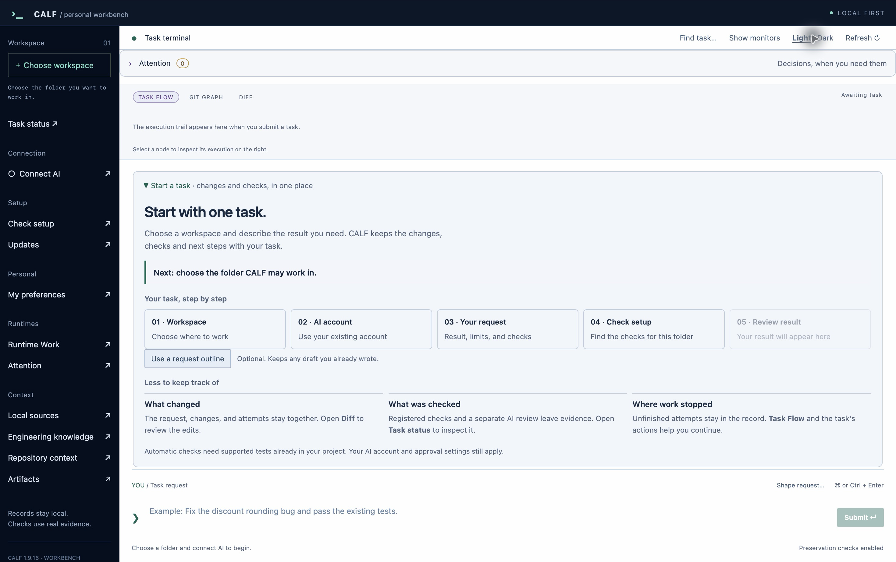
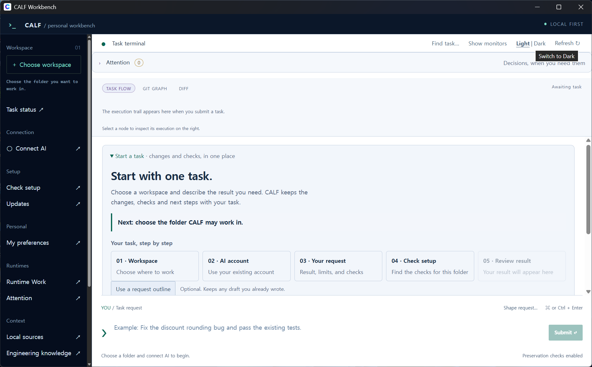
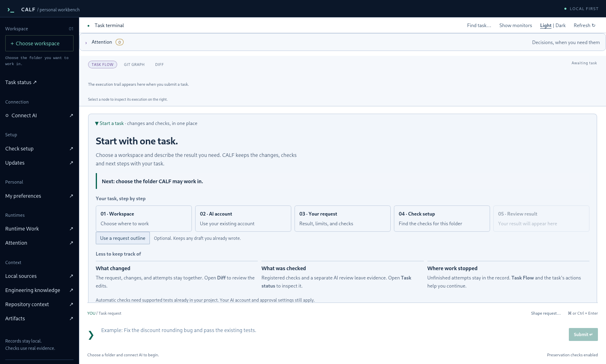

# Workbench 1.9.22 screen guide

## Workbench 1.9.22 — connected task status

Open a card under Connected tasks to read that exact host task. You can do this before choosing a workspace. Refresh status reads the same selected task again.

If the task is missing from a bounded or recently changed task list, Workbench retains its identity and requests that task directly. If its link is no longer readable, the view shows an error instead of displaying another task’s result. Check the existing host connection, then refresh; no restart is needed for this read-only view.

“Response ended” describes a recorded host event. It does not establish process liveness or completion of the whole task. UNKNOWN stays unknown when current completion has not been evaluated.

Sidebar utility panels occupy the central work area. Close or Esc returns to the task view. Switching between panels retains an unsaved preferences draft; Save preferences is the explicit save action.

Upgrade from Workbench 1.9.21 through Updates, or download 1.9.22 and extract it to a new folder. Keep your existing records folder, contracts, preferences and pinned task runtimes. Preparing the update leaves the current window running. Existing linked tasks continue in their original host.

[한국어](UI_GUIDE_KR.md) · [Install](INSTALL.md) · [First task](FIRST_TASK.md)

## Ontology evidence exploration

Current guide: Harness **1.8.24** · Workbench **1.9.22** · SDK **0.2.11**.

Read-only task evidence graphs, historical search and paging, reference navigation, and direct/indirect impact explanations. Existing records, contracts, settings and task execution are preserved. [Guide](ONTOLOGY_GUIDE.md)

## 1.9.20 connected tasks

Select an explicitly linked CALF host journal in **Connected tasks**. **Task status** separates recorded evidence and current observation. Refresh and latest-response tracking do not control host execution. [Guide](HOST_TASKS_PATCH.md). Earlier pictures below retain their version labels.

## 1.9.19 views and task status

Utility views use the center. Close or Escape returns while retaining drafts. In **Task status**, choose a retained task for the folder and read recorded and current observations separately. [Patch guide](UI_STATUS_PATCH.md). Earlier pictures below retain their version labels.

## Add and undo a repeated correction

Open **Shape request… → Things I keep correcting**. Load suggestions, append one after your text, or undo it. [Follow the steps](REQUEST_GUIDANCE.md).

The first-task and result pictures below remain examples from the earlier 1.9.16 release.

## Start with the next action

Read the next step inside **Start a task**, then follow workspace, AI connection, request, check readiness and results. System type distinguishes instructions from monospace paths, commands and records.

## Read the result

| Label | Meaning |
| --- | --- |
| Current | Native verdict for current files and execution context |
| Recorded | Historical result retained from that run |
| Next | The required evidence review, recheck or other next action |

A past SATISFIED remains historical when current evidence is stale and UNKNOWN. A click, an AI completion claim or command exit 0 is not completion proof. Attention exposes a human decision reason and next action without approving or rerunning work.

## Presentation and preservation

Light/Dark changes the center palette. Show/Hide monitors changes visibility. Unsubmitted CJK drafts remain intact. The original icon artwork is retained; the white tile has an 18%-of-side corner radius.

These are actual windows using release executables with separate example records. The result example is a synthetic technical check, not a published customer task or fresh AI delivery. VERIFICATION.json separates OS screen checks, UI regressions and final package tests. No human-time, token-saving or long-duration performance measurement is claimed.

## Add personal material

In **Engineering knowledge → Add a material folder…**, choose Markdown or text files once. CALF checks and indexes them, then connects new tasks automatically. Adding material does not call AI; starting a later AI task sends selected excerpts to the connected provider. Existing selections and original files are retained. [Coverage and use](ENGINEERING_KNOWLEDGE.md).
