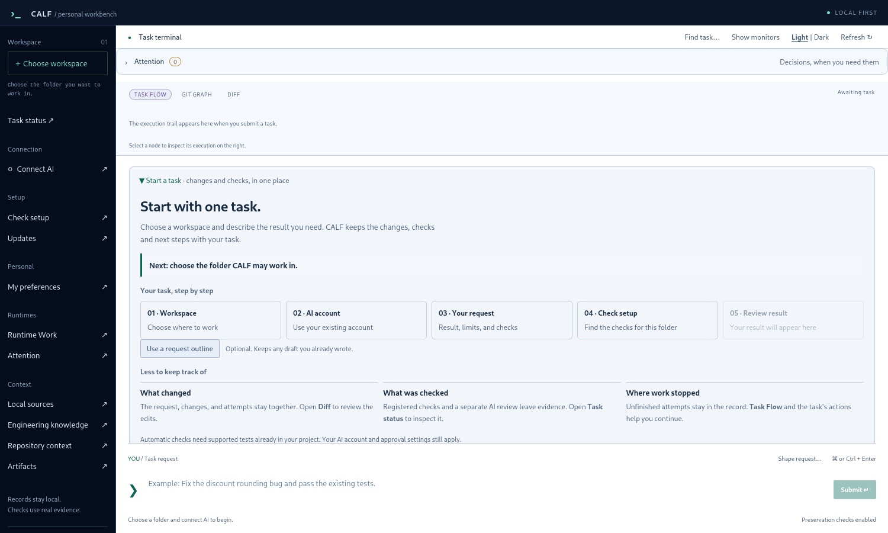
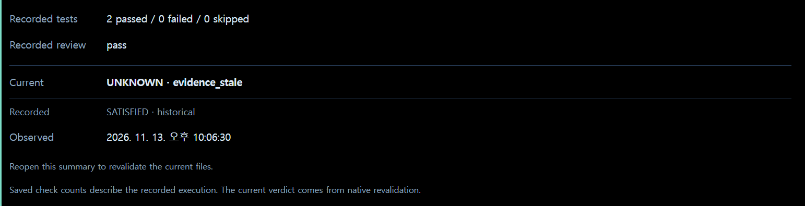

# Workbench 1.9.16 화면 안내

[English](UI_GUIDE.md) · [설치](INSTALL_KR.md) · [첫 작업](FIRST_TASK_KR.md)

## 첫 작업에서 확인할 것

**Start a task**의 다음 안내를 먼저 읽고 폴더·AI 연결·요청·검사 준비·결과를 이어갑니다. 일반 설명은 시스템 글꼴, 경로·명령·기록은 고정폭 글꼴로 구분합니다.

## 결과를 읽는 순서

| 표시 | 의미 |
| --- | --- |
| Current | 현재 파일·실행 문맥에 대한 네이티브 판정 |
| Recorded | 당시 실행에서 보존한 과거 결과 |
| Next | 근거 확인·재검수 등 필요한 다음 행동 |

과거 SATISFIED가 있어도 현재 근거가 오래됐으면 UNKNOWN으로 남습니다. 버튼 클릭·AI의 완료 보고·명령 exit 0만으로 성공 처리하지 않습니다. Attention은 사람이 확인할 사유와 다음 조치를 보여주며 자동 승인·재실행은 하지 않습니다.

## 화면과 기록 보존

Light/Dark는 중앙 작업 영역을 전환합니다. Show/Hide monitors는 창의 모니터 표시를 바꿉니다. 새 작업을 제출하지 않은 한글 초안도 유지됩니다. 흰색 앱 아이콘은 원본을 보존하고 모서리 반경만 변 길이의 18%로 적용했습니다.

사진은 최종 배포 실행 파일을 별도 예제 기록으로 연 실제 창입니다. 결과 예시는 합성 작업의 기술 검증이며 실제 AI 제작물이나 사용자 작업을 공개한 것이 아닙니다. 세 OS의 화면 검증·UI 회귀 검사와 공개 패키지 검증은 VERIFICATION.json에서 구분합니다. 사람의 작업 시간·토큰 절약률이나 장시간 성능을 측정한 자료는 아닙니다.

## 개인 자료 추가

**Engineering knowledge → Add a material folder…**에서 Markdown·텍스트 폴더를 선택하면 검사와 검색용 색인 생성 후 새 작업에 자동 연결합니다. 자료 추가 자체는 AI를 호출하지 않으며, 이후 AI 작업을 시작하면 선택한 발췌문이 연결된 AI에 전달됩니다. 기존 자료 선택과 원본 파일은 보존합니다. [범위와 사용법](ENGINEERING_KNOWLEDGE_KR.md).
